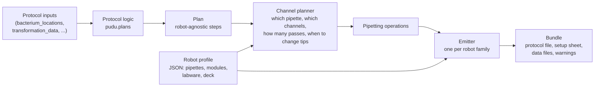

# LabLibre

LabLibre turns a lab protocol into files that a specific liquid-handling robot, or a person at the bench, can run. You describe the protocol once, without naming any robot. LabLibre then compiles it on your laptop for the hardware you pick, and the output needs nothing installed on the robot.

It ships as part of the `pudupy` package, next to `pudu`. PUDU's protocols sit on top of it: `pudu.plans.PlatingProtocol` and `pudu.plans.TransformationProtocol` build LabLibre plans, and LabLibre compiles them.

```python
from lablibre import load_profile
from pudu.plans import PlatingProtocol

protocol = PlatingProtocol(plating_data={"bacterium_locations": {"A1": "GFP", "B1": "RFP"}}, replicates=2)

protocol.compile(load_profile("ot2_default")).write("plating_ot2/")      # Opentrons protocol + setup sheet
protocol.compile(load_profile("bench_default")).write("plating_bench/")  # Markdown bench protocol
```

---

## Contents

1. [Why LabLibre exists](#why-lablibre-exists)
2. [How it works](#how-it-works)
3. [Using it](#using-it)
4. [Plans](#plans)
5. [Robot profiles](#robot-profiles)
6. [The channel planner](#the-channel-planner)
7. [Emitters and bundles](#emitters-and-bundles)
8. [Warnings](#warnings)
9. [How the ports are verified](#how-the-ports-are-verified)
10. [Differences from the original PUDU protocols](#differences-from-the-original-pudu-protocols)
11. [Extending LabLibre](#extending-lablibre)
12. [Limitations and roadmap](#limitations-and-roadmap)
13. [File map](#file-map)

---

## Why LabLibre exists

PUDU's protocols are Python classes that call the Opentrons API directly. That caused four problems:

| Problem | Before | With LabLibre |
|---|---|---|
| **The robot needs PUDU installed.** The generated protocol imported `pudu`, so `pip install pudupy` had to run on the OT-2. That needs the robot on a network with internet access, which university Wi-Fi authentication doesn't allow. | Install on the robot, or it doesn't run. | The generated file imports only `opentrons`, which every OT-2 already has. Upload it through the Opentrons App and run it. |
| **Everything is written for one robot.** Pipette names, deck slots and labware were hard-coded for the OT-2. Running on a Flex or a Hamilton would mean rewriting each protocol. | One robot. | A protocol is written once. Each robot is a profile (a JSON file) plus an emitter. |
| **Manual protocols were written separately.** `ManualPlating` and friends restate the protocol for bench work, so the two versions can drift apart. | Two implementations per protocol. | The bench protocol is one more compile target of the same plan. |
| **Chaining needed simulation.** Assembly, transformation and plating pass well locations along in JSON files that only appear when you run `opentrons_simulate`. | Simulate each step to get the next step's input. | The chaining files (e.g. `plating_input.json`) come straight out of the compile. |

For Hamilton, LabLibre writes CSV worklists for a fixed VENUS method built once on the instrument. That keeps VENUS, its calibrations and its liquid classes in charge, which matters on another lab's instrument. See [Hamilton emitter](#hamilton-emitter-robot-hamilton).

---

## How it works



There are four layers, and each one only knows what it needs:

1. **Protocol logic** (`pudu.plans`) knows the biology: which culture goes into which dilution well, what volumes, which tip may be reused. It builds a **plan** and never names a pipette or a deck slot.
2. **The plan** (`lablibre.Plan`) is a list of steps on logical labware ("dilution_plate_1", a 96-well plate). It can be validated on its own: volumes are tracked through every transfer.
3. **The channel planner** (`lablibre.ChannelPlanner`) reads a **robot profile** and decides *how* each group of transfers runs on that hardware: which pipette, which transfers go together on a multichannel head, how to split large volumes, when to pick up and drop tips.
4. **An emitter** writes those decisions out for one robot family: Python for Opentrons, Markdown for a person, CSV worklists for Hamilton. Emitters make no decisions of their own.

The key split: *what* to do is in the plan, *how* to do it on given hardware is in the planner, and *how to write it down* is in the emitter. Two robot families with the same kind of pipette head (for example the OT-2 and Flex 8-channel pipettes) share planner logic; only the emitter differs.

---

## Using it

### Compile a protocol

```python
from lablibre import load_profile, builtin_profiles
from pudu.plans import PlatingProtocol, TransformationProtocol

print(builtin_profiles())                     # ['bench_default', 'hamilton_star_default', 'ot2_default']

transformation = TransformationProtocol(transformation_data=[
    {"Strain": "https://SBOL2Build.org/strain_GFP/1",
     "Chassis": "https://sbolcanvas.org/DH5alpha/1",
     "Plasmids": ["https://SBOL2Build.org/composite_1/1"]},
])
bundle = transformation.compile(load_profile("ot2_default"))
bundle.write("transformation_ot2/")
```

`transformation_ot2/` now contains:

| File | What it is |
|---|---|
| `transformation.py` | Upload this in the Opentrons App. Imports only `opentrons`. |
| `transformation_setup.md` | Deck map, pipettes and tip counts, liquids to load, warnings, numbered steps. |
| `transformation_plan.json` | The plan itself, for reference or debugging. |
| `plating_input.json` | Input for the plating protocol. |

### Chain protocols without simulating

```python
import json
plating = PlatingProtocol(plating_data=json.loads(bundle.get("plating_input.json").content))
plating.compile(load_profile("ot2_default")).write("plating_ot2/")
```

A transformation can also take DNA straight from an assembly plate: pass `plasmid_locations` (the `transformation_input.json` an assembly run produces).

### Parameters

`PlatingProtocol` and `TransformationProtocol` take the same inputs as `pudu.plating.Plating` and `pudu.transformation.HeatShockTransformation`: the data, `json_params`, and keyword parameters, with the same precedence and validation. They reuse those classes for parameter handling, so behavior matches.

Hardware parameters (pipette names, tip racks, labware, deck positions, flow rates) are rejected with an error pointing to the robot profile. Those now live in the profile, so the same protocol parameters work on any robot.

### Run the simulator on a generated protocol

```bash
python -m opentrons.simulate transformation_ot2/transformation.py
```

---

## Plans

A plan has four parts:

| Part | Created with | Example |
|---|---|---|
| Modules | `plan.add_module(name, kind)` | `plan.add_module("thermocycler", "thermocycler")` |
| Labware | `plan.add_labware(name, format, module=None, max_volume_ul=None, description="")` | `plate = plan.add_labware("dilution_plate", "plate_96")` |
| Starting liquids | `plan.load(well, liquid, volume)` | `plan.load(tubes["A1"], Liquid("LB"), 10000)` |
| Steps | `plan.add(step)` | `plan.add(SetTemperature("thermocycler", 4))` |

Labware is **logical**: a name plus a grid format (`plate_96`, `plate_384`, `tube_rack_24`, `tube_rack_15`, `tube_rack_6`, `reservoir_12`, `reservoir_1`). Indexing it gives a well reference: `plate["A1"]`. The robot profile decides which physical labware that becomes.

### Steps

| Step | Meaning |
|---|---|
| `TransferSet` | A group of liquid transfers that share handling. The main step; see below. |
| `SetTemperature(module, celsius)` | Set a temperature module or thermocycler block. `None` turns it off. |
| `SetLid(module, open)` | Open or close a thermocycler lid. |
| `ThermalProfile(module, steps, repetitions, lid_celsius, block_max_volume, hold_celsius, label)` | Run a cycling program. |
| `MoveLabware(labware, destination)` | Move labware onto a module or off the deck (`OFF_DECK`). |
| `Delay(seconds, message)` | Wait without user interaction. |
| `Pause(message)` | Wait until the user resumes. |
| `Comment(text)` | A note in the run log. |

### TransferSet

A `TransferSet` is a list of `Transfer(source, dest, volume, mix_before=None, mix_after=None, dispense_below_top=None)` plus shared handling:

| Field | Default | Meaning |
|---|---|---|
| `liquid_class` | `AQUEOUS` | `AQUEOUS`, `GLYCEROL` (enzyme stocks) or `CELLS`. Each profile maps these to its own settings (flow rates on Opentrons, notes on the bench). |
| `ordering` | `ANY` | `ANY`: the planner may regroup transfers (they don't depend on each other). `SEQUENTIAL`: keep the listed order; for serial dilutions. |
| `tips` | `NEW_EACH` | `NEW_EACH`: fresh tip per transfer. `PER_SOURCE`: keep the tip while the source stays the same. `ONE`: one tip for the whole set. |
| `multi_dispense` | `False` | One aspiration may serve several dispenses from the same source. |
| `disposal_volume` | `0` | Extra µL aspirated per multi-dispense aspiration and thrown away, for more even dispenses. |
| `air_gap` | `0` | µL of air taken after aspirating (and before each dispense when multi-dispensing). Robots only. |
| `touch_tip`, `blow_out` | `False`, `True` | Touch the tip to the well wall; blow out after dispensing. |
| `label` | `""` | Step name for comments, setup sheets and bench protocols. |

`dispense_below_top` on a transfer dispenses that many mm below the rim instead of at the default height. Plating uses `8` to spot above the agar. Negative values dispense above the rim; transformation uses `-2` for recovery media.

Rules checked when a step is created:

- `mix_after` can't be combined with `PER_SOURCE` tips. The tip would carry the destination back into the source.
- `multi_dispense` needs a tip policy that reuses tips, and no `mix_after`. `mix_before` is allowed; it mixes the source before each aspiration.

### Validation

`plan.check()` raises `PlanError` listing every error, and returns warnings. It tracks the volume in every well through the whole protocol:

- **Errors:** a source that runs dry; a well used as a source before anything was put in it; a well filled beyond its `max_volume_ul`; a step aimed at a missing module or the wrong kind of module.
- **Warnings:** a mix larger than the liquid in the well.

---

## Robot profiles

A profile is a JSON file describing one robot, or the bench. Three ship with LabLibre: `ot2_default` (PUDU's usual OT-2 setup), `bench_default` (P2 to P1000 pipettes, a cold block, a thermocycler) and `hamilton_star_default` (an 8-channel STAR with placeholder names; see [Hamilton emitter](#hamilton-emitter-robot-hamilton)). Copy one to describe your own hardware and load it with `RobotProfile.from_json(path)`.

```json
{
  "robot": "ot2",
  "name": "OT-2 (PUDU defaults)",
  "pipettes": [
    {"name": "p20_single_gen2", "channels": 1, "min_volume": 1, "max_volume": 20,
     "mount": "left", "tip_rack": "opentrons_96_filtertiprack_20ul"},
    {"name": "p300_single_gen2", "channels": 1, "min_volume": 20, "max_volume": 200,
     "mount": "right", "tip_rack": "opentrons_96_filtertiprack_200ul"}
  ],
  "modules": [
    {"kind": "temperature", "model": "temperature module gen2", "location": "1"},
    {"kind": "thermocycler", "model": "thermocycler module", "location": "7"}
  ],
  "labware": {
    "plate_96": "nest_96_wellplate_100ul_pcr_full_skirt",
    "tube_rack_24": "opentrons_24_tuberack_eppendorf_1.5ml_safelock_snapcap",
    "tube_rack_24@temperature": "opentrons_24_aluminumblock_nest_1.5ml_snapcap"
  },
  "deck_slots": ["2", "3", "4", "5", "6", "9"],
  "liquid_classes": {
    "aqueous": {"aspiration_rate": 0.5, "dispense_rate": 1.0},
    "glycerol": {"aspiration_rate": 0.3, "dispense_rate": 0.5},
    "cells": {"aspiration_rate": 0.5, "dispense_rate": 0.5}
  },
  "options": {"api_level": "2.21"}
}
```

| Field | Meaning |
|---|---|
| `robot` | Which emitter compiles for it: `ot2`, `manual` or `hamilton`. |
| `pipettes` | Each head: `channels`, volume range, `mount`, `tip_rack`. Multichannel heads add `pitch` (`fixed` for Opentrons, `independent` for Hamilton), `per_channel_volume`, and `partial_pickup` (can it use a single tip). |
| `modules` | Installed modules: kind, model name, location. Plan modules the robot lacks become manual pauses. |
| `labware` | Maps plan labware to robot labware. Lookup order: the labware's **name**, then **`format@module kind`**, then the **format**. The middle form puts an aluminum block, not a plastic rack, on the temperature module. |
| `deck_slots` | Free slots, filled in order by labware, then tip racks. |
| `supports_multi_dispense` | `false` turns multi-dispense steps into ordinary transfers, for robots or methods that do one dispense per aspiration. Default `true`. |
| `liquid_classes` | Per-robot handling for each liquid class. The OT-2 emitter reads `aspiration_rate` and `dispense_rate`; the bench emitter reads `note`; the Hamilton emitter reads `liquid_class` (a VENUS liquid class name). |
| `options` | Emitter settings. OT-2: `api_level`. Hamilton: `method`, `positions`, `note`. Both: `locations` to pin labware, e.g. `{"agar_plate_1": "9"}`. |

The OT-2 aqueous rates match PUDU's current defaults. The glycerol and cells rates are starting guesses to tune on the robot.

---

## The channel planner

For each `TransferSet`, the planner decides which head does each transfer, which transfers run together, how many passes a volume needs, and when tips change. It works by **what a head can do**, not by brand:

| Head | Groups transfers when | Examples |
|---|---|---|
| Fixed-pitch multichannel | One transfer per channel covering a full column (8-channel) or a full plate (96-channel), rows lined up between source and destination (or all drawing from one reservoir well), same volume and mixing. | OT-2 and Flex 8-channel, 96-channel heads |
| Independent channels | Up to N transfers with different destinations and different tubes (a reservoir may be shared); volumes may differ per channel. | Hamilton STAR |
| Single channel | Everything else. A multichannel head that can pick up one tip (`partial_pickup`) also counts. | p20, p300, bench pipettes |

Rules it follows:

- **Largest head first, falling back to single channel.** An incomplete column falls back to a single-channel pipette.
- **Pipette choice:** a pipette that can also do the transfer's mix; then the fewest aspirations; then the smallest pipette. A 2 µL transfer with a 19 µL mix goes to a P20, not a P2.
- **Large volumes are split into equal passes.** 90 µL on a p20 becomes 5 × 18 µL, not 4 × 20 + 10. Mixing before goes on the first pass, mixing after on the last.
- **Order:** with `ANY`, transfers may be regrouped. With `SEQUENTIAL`, only consecutive transfers are grouped, and never one that draws from a well another transfer in the group fills.
- **Multi-dispense:** transfers are grouped by geometry, then consecutive groups drawing from the same source are chained into one aspiration each. The pipette is chosen for the whole chain, so LB can be multi-dispensed with a p300 even though each 18 µL dispense is below its 20 µL minimum. Only the aspiration has to meet the minimum. If no pipette can multi-dispense a chain, it becomes ordinary transfers.
- **Independent-channel heads** (a Hamilton lists one per tip size on the same channels): each transfer first goes to its best tip size, then transfers of the same tip size are packed onto the channels.
- **Tips** are handled per pipette according to the tip policy. `TransferPlan.tips_used()` counts them.

The planner's output is a list of operations per step: `PickUpTips`, `TransferPass` (one aspirate and dispense, all channels at once), `DistributePass` (one aspiration, several dispenses) and `DropTips`.

---

## Emitters and bundles

`compile_plan(plan, profile)` picks the emitter for `profile.robot`. It validates the plan, runs the planner, and returns a `Bundle`: a list of files, each tagged as `protocol`, `worklist`, `setup` or `data`, plus `warnings`. `bundle.write(directory)` saves the files.

### OT-2 emitter (`robot: "ot2"`)

Writes a protocol that reads top to bottom:

```python
    # Step 3: Distribute LB to dilution wells
    protocol.comment('Step 3: Distribute LB to dilution wells')
    p300_single_gen2.pick_up_tip()
    _distribute(p300_single_gen2, lb_tubes['A1'], [
        (dilution_plate_1['A1'], 18),
        (dilution_plate_1['B1'], 18),
        (dilution_plate_1['A7'], 18),
        (dilution_plate_1['B7'], 18),
    ], protocol.fixed_trash, disposal=4, **HANDLING['aqueous'])
    p300_single_gen2.drop_tip()
```

- Modules, labware, tip racks, pipettes and liquids are loaded at the top. Liquids show in the Opentrons App's deck view.
- Every step has a comment and a `protocol.comment`, so it shows in the run log.
- Two small helpers, `_move` and `_distribute`, are included only when used. A `HANDLING` table at the top holds the flow rates per liquid class, for editing by hand.
- Labware fills free slots automatically. Tip racks are loaded from the planner's tip counts. Missing modules become pauses asking for that step by hand.
- It also writes a setup sheet (deck map, pipettes, tip counts, liquids to load, warnings, steps).
- Supports 1- and 8-channel pipettes, the temperature module and the thermocycler.

### Bench emitter (`robot: "manual"`)

Writes a Markdown protocol for a person: equipment with tip counts, reagents to prepare, and numbered steps with a transfer table per step.

| # | Tip | Pipette | From | To | Volume (µL) | Notes |
|---|---|---|---|---|---|---|
| 1 | new | P20 | `culture_plate` A1 | `dilution_plate_1` A1 | 2 | mix 5 × 19 µL after |
| 2 |  | P20 | `dilution_plate_1` A1 | `dilution_plate_1` A7 | 2 | mix 5 × 19 µL after |
| 3 |  | P20 | `dilution_plate_1` A1 | `agar_plate_1` A1 | 4 | dispense 8 mm below the rim |

Pipette choice, tip changes, repeat-dispensing and volume splits come from the same planner the robots use. Thermocycler programs become tables. Lid steps are left out; they're part of running the thermocycler.

### Hamilton emitter (`robot: "hamilton"`)

A Hamilton STAR is driven by VENUS on an attached PC. LabLibre doesn't generate VENUS methods. It writes CSV worklists for **one method built once on the instrument** that reads a worklist and runs it row by row. VENUS keeps its deck layout, calibrations and liquid classes, and nothing is installed on the PC.

The bundle contains:

| File | What it is |
|---|---|
| `<name>_worklist_1.csv`, `_2.csv`, … | One per stretch of pipetting. Steps the method can't do (thermocycling, temperature, pauses) split the protocol into several worklists. |
| `<name>_run_sheet.md` | Deck layout (plan labware → deck labware IDs), tips per tip type, liquids to load, warnings, the run order ("run worklist 1; move the plate to the thermocycler and run…; put it back at Plate_1; run worklist 2"), and the worklist column reference. |
| `<name>_plan.json` | The plan. |

Each worklist row is **one channel's aspirate and dispense**:

| Column | Meaning |
|---|---|
| `Step` | Plan step number, as in the run sheet. |
| `Batch` | Rows with the same batch run at the same time, one per channel. Numbered from 1 in each file. |
| `Channel` | Channel to use, from 1. |
| `TipType` | Tip type to pick up (the pipette's `tip_rack` in the profile). |
| `NewTip` / `DropTip` | 1: pick up a fresh tip before aspirating / drop it after dispensing. |
| `SourceLabware`, `SourceWell`, `SourcePosition` | Deck labware ID, well name, and the well as a number counted down each column (A1 = 1, B1 = 2, …). |
| `DestLabware`, `DestWell`, `DestPosition` | The same for the destination. |
| `Volume_uL` | Volume to aspirate and dispense. |
| `LiquidClass` | VENUS liquid class, from the profile. |
| `AspMixCycles`, `AspMixVolume_uL` | Mix in the source before aspirating (0: none). |
| `DispMixCycles`, `DispMixVolume_uL` | Mix in the destination after dispensing (0: none). |
| `DispenseBelowTop_mm` | Blank: the liquid class decides. Otherwise dispense this far below the rim (negative: above it). |
| `TouchTip` | 1: touch the tip to the well wall after dispensing. |

Air gaps and blow-outs come from the liquid class.

How the profile describes the instrument (`profiles/hamilton_star_default.json`):

- **Tip sizes are separate pipettes** on the same 8 independent channels (`50uL tips`, `300uL tips`, `1000uL tips`), so the planner picks the smallest tip that fits. Because they share channels, the emitter drops one tip size before picking up another.
- **`supports_multi_dispense: false`**, so each row is one aspirate and one dispense.
- **`options.positions`** lists the deck layout's labware IDs per format; labware is assigned in order. **`options.method`** names the VENUS method.
- **Modules:** the method controls none. Labware the plan keeps on a module sits on the deck, with a warning, and thermocycler steps become run-sheet instructions.

All names in the default profile (tip types, liquid classes, method, position IDs) are **placeholders**. They must be set to match the method and deck layout on the actual instrument; the run sheet repeats this note.

---

## Warnings

Some things compile but deserve a look before a run. Each one appears in four places:

- raised as a `LabLibreWarning` by `compile_plan`, so scripts print it;
- listed in `bundle.warnings`;
- written into the OT-2 code as a `# Warning:` comment at that step, and in the setup sheet;
- listed in the bench protocol, with a note on the affected row.

Current warnings:

- **A mix reduced to fit the pipette.** For example, 1 µL of ligase must go on a P2, so an 8 µL mix after it becomes 2 µL.
- **A mix larger than the liquid in the well** (from plan validation).

---

## How the ports are verified

The ports claim to do the same thing as the original classes, so the tests check that directly. For each scenario they:

1. run the **original** PUDU class (`Plating`, `HeatShockTransformation`) through the Opentrons simulator;
2. compile the **port** for the OT-2 and run the generated file through the same simulator;
3. compare every tip pickup, tip drop, aspirate, dispense and air gap: volume, well, and which plate (culture, dilution, agar, DNA, reagents);
4. compare the chaining output (`plating_input.json`) with what the original wrote.

A separate test makes sure a deliberately wrong run fails the comparison, so the check can't pass vacuously. Flow rates, deck slots and blow-outs are left out of the comparison on purpose (see the next section).

| Test file | What it covers |
|---|---|
| `tests/test_lablibre_core.py` | Wells, labware, steps, plan validation, profiles, bundles |
| `tests/test_lablibre_planner.py` | Every head type, tip policy, splitting, multi-dispense, head choice |
| `tests/test_lablibre_ot2_emitter.py` | Generated protocols, all run in the Opentrons simulator |
| `tests/test_lablibre_manual_emitter.py` | Bench protocols |
| `tests/test_lablibre_hamilton_emitter.py` | Hamilton worklists and run sheets |
| `tests/test_pudu_plans_plating.py` | Plating parity with `Plating` (3 scenarios, up to 1,026 events) |
| `tests/test_pudu_plans_transformation.py` | Transformation parity with `HeatShockTransformation` (4 scenarios), chaining into plating |

Run them with:

```bash
PYTHONPATH=src python -m pytest tests/test_lablibre_*.py tests/test_pudu_plans_*.py
```

---

## Differences from the original PUDU protocols

The pipetting is the same. These differences are deliberate:

| Area | Original | Port | Why |
|---|---|---|---|
| Deck slots | Fixed per protocol | Assigned from the profile's free slots | Pin slots with `options.locations` if you want the old layout. |
| Flow rates | One `aspiration_rate`/`dispense_rate` per protocol | Per liquid class, from the profile | Enzymes and cells need different handling from water. Set `cells` to 0.5/1.0 to match PUDU exactly. |
| Plating LB | Refilled every 8 wells (so `SmartPipette` could lower the aspiration height) | As many wells per aspiration as fit | `SmartPipette`'s conical-tube height logic is not ported (lab decision). |
| Plating culture plate | Bio-Rad 200 µL plate | The profile's plate on the thermocycler (NEST 100 µL) | Transformation produces a NEST plate, so NEST is what arrives. |
| Transformation DNA | Blow-out, then the "remove air" step | "Remove air" as a mix, then blow-out | Same pipetting; blowing out afterwards leaves the tip empty. |
| Transformation `block_max_volume` | 30 µL for both programs | The actual well volume (e.g. 24 and 84 µL) | The recovery wells hold about 84 µL, not 30. |
| Simulation | Temperature steps skipped whenever simulated | Always included; `water_testing=True` removes them | The generated file runs the same in the simulator and on the robot. |
| Tip racks | One rack per pipette | As many as the tip count needs | The original runs out of tips above about 47 plating constructs. |

---

## Extending LabLibre

### Add a protocol

Build a `Plan` from the protocol's inputs. The ports in `src/pudu/plans/` are the templates:

```python
from lablibre import Plan, Liquid, TransferSet, TipPolicy, transfers, compile_plan, load_profile

plan = Plan("Fill plate")
reservoir = plan.add_labware("reservoir", "reservoir_12")
plate = plan.add_labware("plate", "plate_96", max_volume_ul=200)
plan.load(reservoir["A1"], Liquid("media"), 15000)
plan.add(TransferSet(transfers([(reservoir["A1"], w, 100) for w in plate.wells()]),
                     tips=TipPolicy.ONE, multi_dispense=True, label="Fill plate"))

compile_plan(plan, load_profile("ot2_default")).write("fill_plate/")
```

On `ot2_default` (single-channel pipettes) this compiles to 48 aspirations with one tip. Give the profile a `p300_multi_gen2` instead and the same plan compiles to 4 aspirations of three columns each, with one pickup of 8 tips. The plan doesn't change.

### Add a robot

1. Write a profile JSON with the robot's pipettes, modules, labware names and deck slots.
2. Write an emitter: a subclass of `Emitter` with `robots = ("your_robot",)` and a `compile(plan, profile)` that runs `ChannelPlanner` and turns each operation into the robot's format. `emitters/opentrons.py` and `emitters/manual.py` are the references.
3. Register it in `lablibre/emitters/__init__.py`.

The planner already handles fixed-pitch, independent-channel and single-channel heads, so a new emitter mostly translates.

---

## Limitations and roadmap

**Not built yet**

- **The VENUS worklist method** on the Hamilton itself, built once with the other lab to read the columns above. Then the profile's placeholder names get replaced with the instrument's.
- **Flex emitter.** Mostly slot names, pipette and tip-rack names, and the gripper; small after the OT-2 emitter.
- **Assembly port.** The last of PUDU's main protocols.

**Known limitations**

- Tip-rack batch swapping: if a run needs more racks than there are free slots, compiling fails with "Out of deck slots" rather than pausing for a swap.
- Partial-column grouping: leftover wells in an incomplete column use a single-channel pipette, even on a Flex that could pick up a few tips.
- Hamilton channel reach isn't modeled; the planner assigns channels in row order and leaves reachability to the VENUS method.
- Hamilton: no multi-dispense, no CO-RE 96 head, and no on-deck module control yet.
- Multi-dispense packs greedily, so a small final aspiration can rule out a pipette. Balancing the chunks would fix this.
- Plan validation doesn't count disposal volume drawn from a source, because the number of aspirations depends on the robot.
- Construct names passed from transformation to plating keep PUDU's format (`strain, Competent_Cell_..., plasmid, Media_1`).

---

## File map

| Path | Contents |
|---|---|
| `src/lablibre/labware.py` | Well names, labware formats, logical labware, well references |
| `src/lablibre/modules.py`, `liquids.py` | Module kinds; liquids and liquid classes |
| `src/lablibre/steps.py` | Step types, `Transfer`, `TransferSet`, tip and ordering policies |
| `src/lablibre/plan.py` | `Plan`, validation with volume tracking, JSON export |
| `src/lablibre/profile.py`, `profiles/` | `RobotProfile`, `PipetteSpec`, built-in profiles |
| `src/lablibre/planner.py` | `ChannelPlanner` |
| `src/lablibre/ops.py` | Planner output: tips, passes, warnings |
| `src/lablibre/bundle.py` | `Bundle`, output files |
| `src/lablibre/emitters/` | `compile_plan`, the OT-2, bench and Hamilton emitters |
| `src/pudu/plans/` | `PlatingProtocol`, `TransformationProtocol` |
